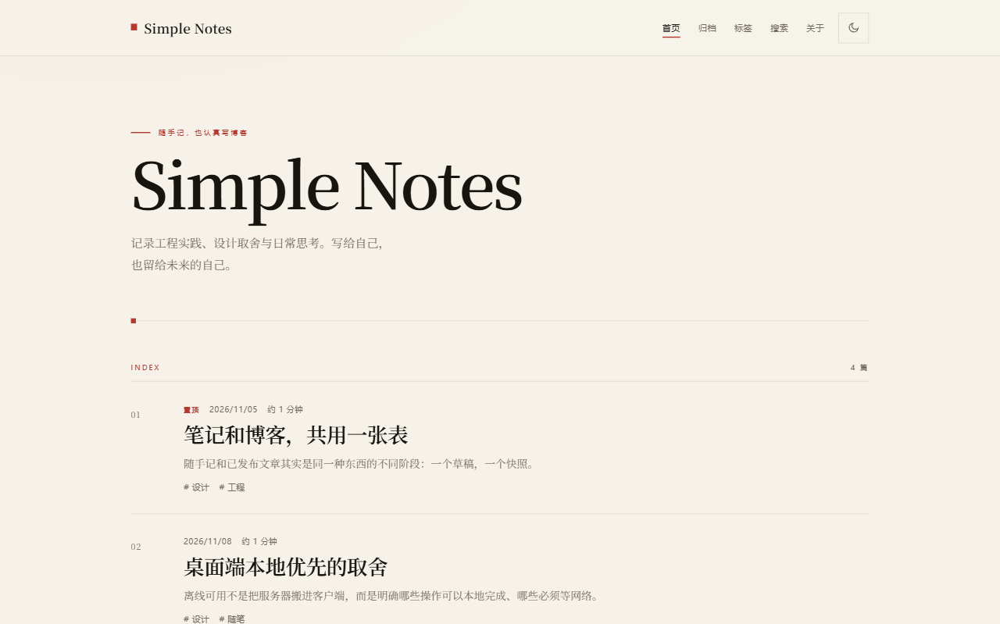
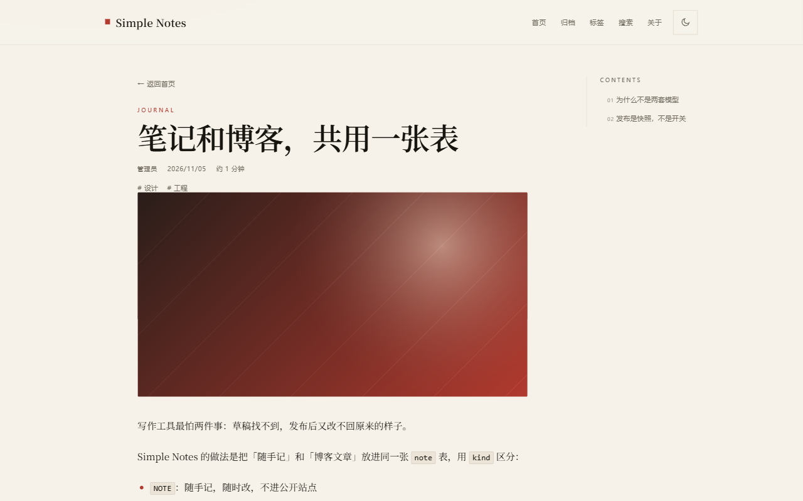
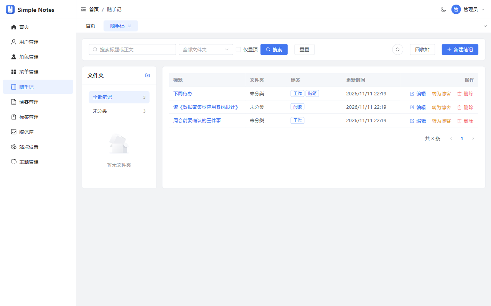
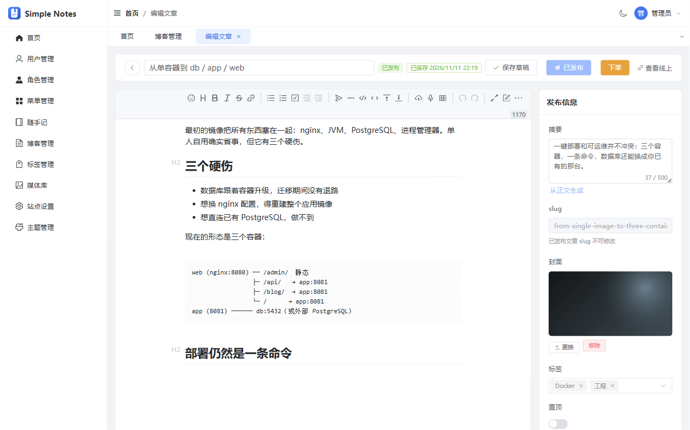
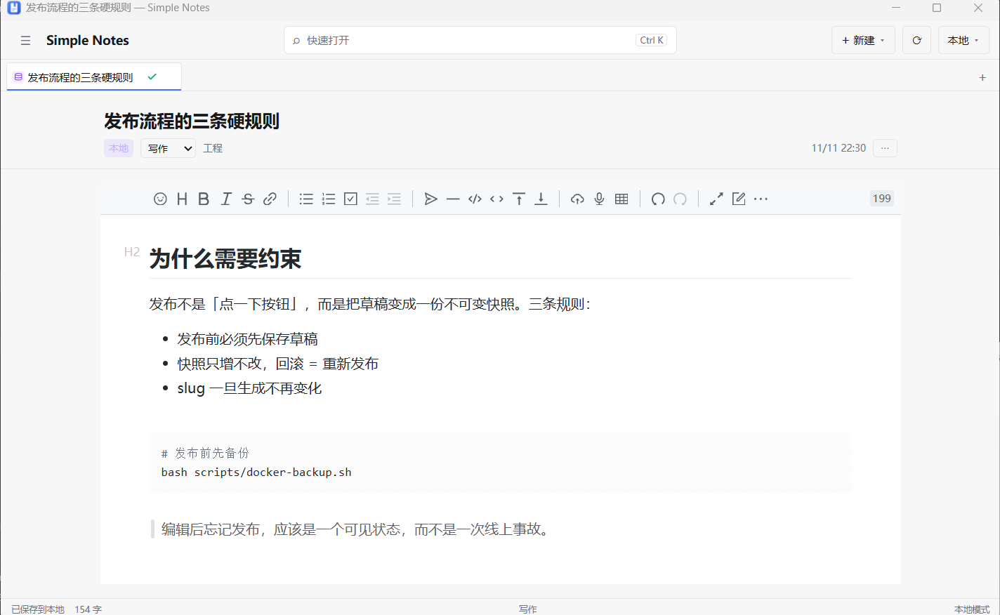
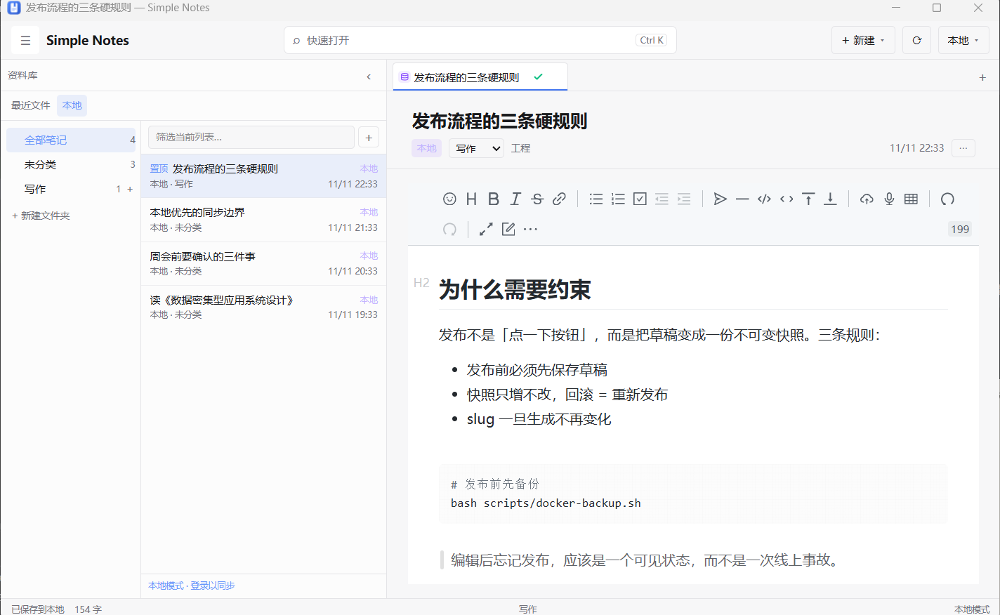

# Simple Notes

随手记 + 个人博客，本地优先的桌面端，以及一套可自托管的服务端。

- `backend/`：Spring Boot 4 / Java 25 / PostgreSQL（内容、RBAC、主题、附件、同步 API）
- `frontend/`：Vue 3 + Vite 工作区（管理端、博客 runtime、桌面端 UI）
- `desktop/`：Go + Wails v3 桌面壳（Windows / macOS / Linux）
- `docs/`：设计文档与验收记录（先读 `docs/tech-stack.md`）

> 状态：**预发布（pre-1.0）**——功能可用、部署链路已端到端验证，但接口与数据结构仍可能破坏性调整；升级前请先备份。

## 特性

- **随手记 + 博客共用一套内容模型**：草稿随便改，发布走快照，编辑后必须「更新发布」
- **三端同源 Markdown**：admin / 博客 / 桌面端统一 Vditor + Lute，方言白名单一致
- **桌面端本地优先**：离线可写、多标签、本地 Markdown 文件、启动恢复，联网后按版本同步
- **可选：对话式改主题**：AI 产出的是受契约约束的补丁，校验通过才能预览，人工确认才会应用
- **部署轻**：3 容器一键起，可直连已有 PostgreSQL；admin 还能交给裸机 nginx

> AI 主题为可选项：需要自备 OpenAI 兼容端点（DeepSeek / Qwen / 本地 Ollama 等）。
> 未配置时功能关闭，不影响启动与其他功能。详见 [`docs/theme-ai.md`](docs/theme-ai.md)。

## 界面

同一个实例、同一套演示数据，三个端各自长这样：

<p align="center">
  
  
</p>
<p align="center"><sub>博客前台 · 首页 / 文章详情（默认主题 Ink &amp; Paper）</sub></p>
<p align="center">
  
  
</p>
<p align="center"><sub>管理端 · 随手记 / 文章编辑与发布</sub></p>
<p align="center">
  
  
</p>
<p align="center"><sub>桌面端（Windows）· 多标签编辑 / 推挤式资料库</sub></p>

## Docker 部署（3 容器：db + app + web）

前提：Docker Engine 24+ / Compose v2+（Windows 建议在 WSL2 内运行）。

```bash
bash scripts/init-env.sh          # 生成 .env（随机 DB 口令 / JWT / root 初始口令）
docker compose up -d --build

# 受限网络 / 代理
# bash scripts/docker-build.sh all
# docker compose up -d --no-build
```

打开：

- 管理端：<http://localhost:8080/admin/>
- 博客：<http://localhost:8080/>

初始口令：

```bash
grep ROOT_INITIAL_PASSWORD .env
```

root 仍是迁移默认口令时该变量必填（缺失会拒绝启动），首次登录后请在个人中心改密。

数据：`./data/media`（上传文件）、`./data/logs`、named volume `simple-notes-pg`（PostgreSQL）。
备份与恢复：

```bash
bash scripts/docker-backup.sh
bash scripts/docker-restore.sh backup/<时间戳>
```

支持直连已有 PostgreSQL（`.env` 的 `DB_URL` / `DB_USERNAME` / `DB_PASSWORD`），
也支持 admin 静态产物放到裸机 nginx（blog 仍由 app 提供）。
详见 [`docs/deployment.md`](docs/deployment.md)，构建与发版见 [`docs/release.md`](docs/release.md)。

## 本地开发

```bash
cd frontend && pnpm install && pnpm typecheck
pnpm dev:admin            # 5173
pnpm dev:blog             # 5174（页面走后端 8080）

cd backend && ./mvnw spring-boot:run   # 8080，默认 dev profile
cd desktop && wails3 dev               # 需要图形环境
```

约定与边界见根 `AGENTS.md` 与各端 `AGENTS.md`。

## 许可

代码以 [MIT](LICENSE) 授权。安全策略与已知设计边界见 [`SECURITY.md`](SECURITY.md)。

`assets/brand/` 下的 logo 与图标仅随本项目分发，不在 MIT 授权范围内。
