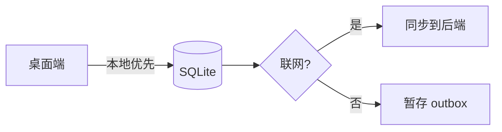
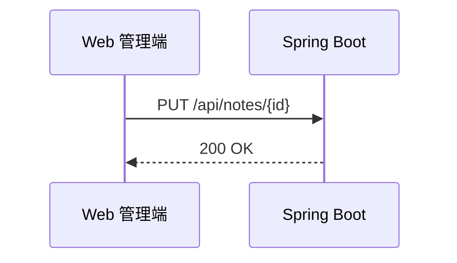
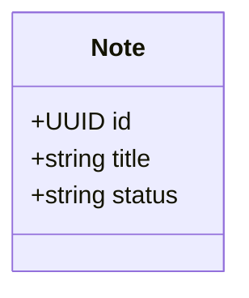
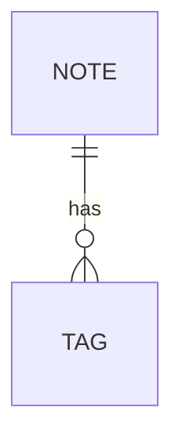
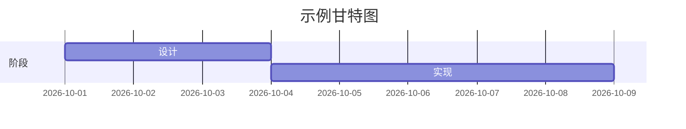

# Markdown 方言验收样本（fixture）

> **用途**：在 admin / blog / 桌面端三个渲染端分别渲染本文件，逐节对比渲染结果并填写记录表。
> 对应规范：`docs/markdown-dialect.md`（v2.1，2026-10-31）
> 标注 **✗ 预期为纯文本** 的节属于边界样本，用于验证清洗 / 降级行为。
>
> 2026-10-25 起 admin / blog 统一为 Lute（Vditor）；2026-10-31 起桌面端迁移到 Vditor 4.0.1 + Lute，三端同源，桌面渲染记录待补。

本文件不需要发布，仅作验收用途。

## 验收记录

| 版本 | 日期 | 管理端预览 | 博客前台 | 桌面预览 | 差异备注 |
| --- | --- | --- | --- | --- | --- |
| v1 | （填写） | ⬜ | ⬜ | ⬜ | 历史记录 |
| v2 | 2026-10-25 | ✅ POC 子集 | ✅ POC 子集 | —（待迁移） | 数学 / emoji / callout / Mermaid / 任务列表 / `vue` 高亮 / HTML 清洗已验证；完整 fixture 待人工走查 |

---

## 1. 基线（CommonMark）

### 1.1 标题与强调

#### 四级标题
##### 五级标题

粗体 **bold**、斜体 *italic*、粗斜体 ***both***、删除线 ~~gone~~。

### 1.2 列表

- 无序项
- 嵌套
  - 第二层
    1. 有序混排
    2. 继续编号

1. 有序项一
2. 有序项二

### 1.3 引用与链接

> 一级引用
>
> > 嵌套引用

[内联链接](https://example.com) 与自动链接 https://example.com

### 1.4 行内代码与换行

行内代码 `const x = 1` 夹在中文之间也应正常。

这是第一行（软换行）  
这是行尾双空格后的第二行（硬换行；三端表现需一致）。

### 1.5 分隔线

---

## 2. GFM 增量

### 2.1 表格（对齐与转义）

| 左对齐 | 居中 | 右对齐 |
| :--- | :---: | ---: |
| a | b | c |
| `\|` 转义管道符 | 长文本换行测试长文本换行测试长文本换行测试 | 123 |
| 中文内容 | **强调**与`代码` | https://example.com |

### 2.2 任务列表

- [x] 已完成的待办
- [ ] 未完成的待办
  - [x] 嵌套待办（缩进两层）

### 2.3 删除线与自动链接

~~已废弃的方案~~ 现在使用 https://github.com/AvaloniaUI/Avalonia

## 3. 代码块（语言集抽查）

```java
public record NoteDto(UUID id, String title) {}
```

```ts
const client = createApiClient({ baseUrl: '/api' })
```

```sql
SELECT id, title FROM notes WHERE deleted_at IS NULL ORDER BY updated_at DESC;
```

```bash
pnpm install && dotnet build -c Release
```

```json
{ "apiBaseUrl": "http://localhost:8080/api" }
```

```yaml
packages:
  - apps/*
  - packages/*
```

无语言标识的围栏（预期：无语法高亮、等宽字体）：

```
普通文本，不应有语法高亮
```

四反引号围栏（内层三反引号不应截断——预期：三端均正确显示为一个代码块）：

````
```java
// 内层三反引号
```
````

## 4. Mermaid（承诺图种）

### 4.1 流程图



### 4.2 时序图



### 4.3 类图



### 4.4 ER 图



### 4.5 非承诺图种（甘特图；仅记录降级表现）



预期：三端均可正常渲染（Lute / Mermaid）；图种不承诺像素级一致，记录实际表现。

## 5. 提示块（GitHub Alerts）

> Lute 输出 `.callout[data-subtype]` 结构；主题按该结构着色（不再使用 `.markdown-alert-*`）。

> [!NOTE]
> 补充说明信息。

> [!TIP]
> 小技巧：可以在这里写快捷方式。

> [!IMPORTANT]
> 重要信息，读者必须知道。

> [!WARNING]
> 需要注意的风险。

> [!CAUTION]
> 高风险操作警告。

## 6. 白名单验证（v2：渲染 / 清洗）

### 6.1 安全 HTML（允许，但必须清洗）

<div class="test">这段 HTML 应被清洗后按安全标签渲染</div>

行内 HTML：<b>加粗应生效</b>； 的 `onerror` 必须被移除。

### 6.2 front matter 样式 ✗ 预期为普通文本

---
title: 这段文本不应被解析为元数据

---

### 6.3 数学公式（预期：KaTeX 渲染）

行内 $E = mc^2$ 与块级公式：

$$
\int_0^1 x^2 \, dx = \frac{1}{3}
$$

### 6.4 脚注（预期：底部脚注区）

这是一个脚注引用[^demo]。

[^demo]: 脚注定义，应出现在文末脚注区域。

### 6.5 其他 v2 扩展（预期：渲染）

==高亮==、H~2~O（下标）、X^2^（上标）、:smile:（Emoji）均应渲染；`` 仍按普通文本处理。

## 7. 图片（alt 与加载失败占位）


预期：加载失败时显示 alt 文本或占位符；三端策略记录在验收表。

## 8. 中文排版抽查

中文段落中夹杂 `inline code`、**粗体强调**、English words 与标点（，。：；「」）的排版效果；行内代码 `变量名` 与中文之间的间距；长链接 https://github.com/AvaloniaUI/Avalonia/blob/master/README.md 的换行行为。

预期：中英文混排无异常断行；行内代码背景不破坏行高；长链接可换行不溢出。
